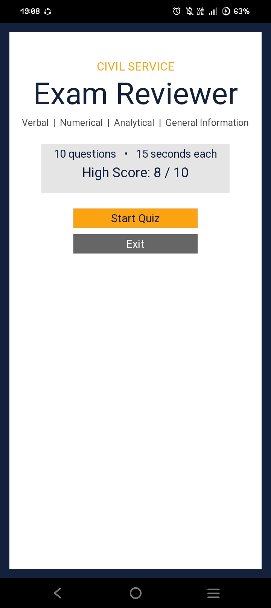
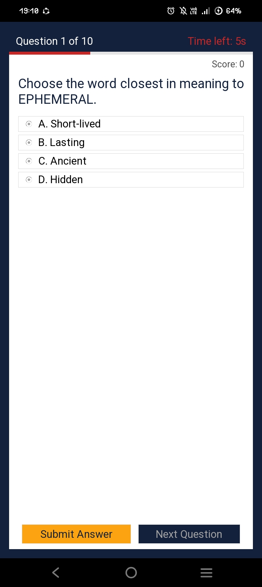
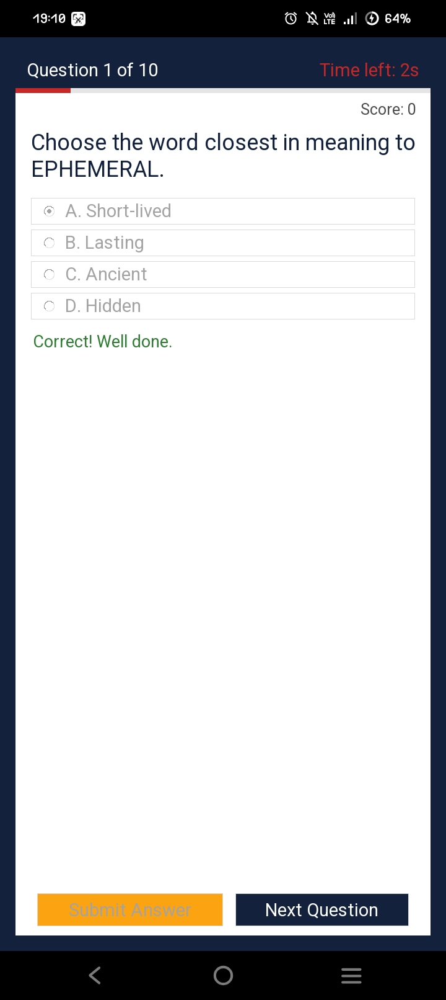
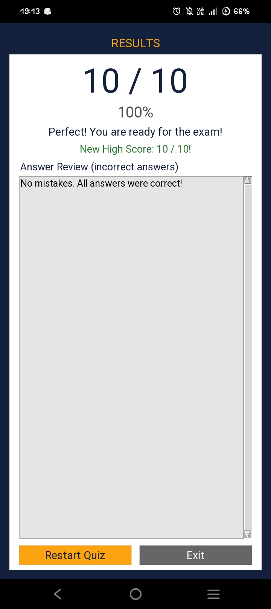
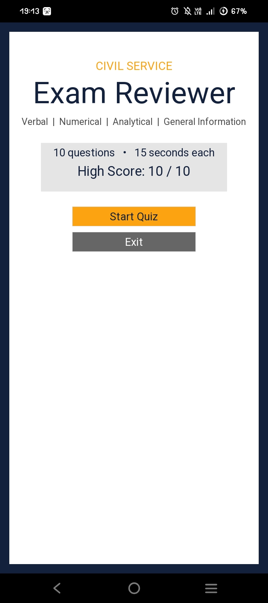

# CIVIL SERVICE EXAM REVIEWER
 
**Name:** Salvador Z. Abuel Jr.
**Section:** SE-3A
**Topic:** Civil Service Exam
 
## Features Completed
10 multiple-choice questions
Random question order
15-second countdown timer
Answer checking and time-out handling
Score and percentage
Answer review
High score saved in a text file
Restart button

## How the Questions Are Stored and Shuffled
All questions live in a list called `QUESTIONS`. Each question is a dictionary with three keys: `"question"` (the text), `"choices"` (a list of four strings that each begin with a letter, like `"A. Short-lived"`), and `"answer"` (just the letter of the correct choice, like `"A"`).

When the quiz starts, `start_quiz()` calls `random.sample(QUESTIONS, len(QUESTIONS))`. This builds a new list containing every question in random order, so the original `QUESTIONS` list is never changed. The shuffled copy is stored in `quiz_questions`, and a counter called `current_question` tracks which one is being shown. Only the order of the questions is shuffled; the A-D choices inside each question stay in their written order. Every restart reshuffles.

## How the Timer Works
Each question gets `TIME_LIMIT = 15` seconds. When a question is displayed, `time_left` is reset to 15 and `update_timer()` is called. Each time it runs, it updates the "Time left" label and redraws the progress bar on a Canvas, shrinking it in proportion to `time_left / TIME_LIMIT`. Both turn red when 5 seconds or fewer remain. Then it subtracts 1 and schedules itself again with `root.after(1000, update_timer)`, so it repeats once per second. The ID of the scheduled call is saved in `timer_job`.

The timer stops in these ways:
- **Time runs out:** when `time_left` reaches 0, `update_timer()` calls `time_up()` and stops rescheduling itself. `time_up()` locks the choices, records the question as wrong ("No answer"), and shows the correct answer.
- **The user submits an answer:** `submit_answer()` calls `stop_timer()`, which uses `root.after_cancel(timer_job)` to cancel the pending call, then resets `timer_job` to `None`.
- **A new question loads or the window closes:** `show_question()` and `on_close()` also call `stop_timer()` so an old timer never keeps running in the background.

As a safety check, `update_timer()` returns immediately if the `answered` flag is `True`.

## How the Program Identifies the Correct Answer
Each choice is a Radiobutton whose `value` is the first character of the choice text (`choice[0]`), which is its letter. All the Radiobuttons share one `StringVar` called `selected_answer`, so when the user clicks an option, `selected_answer` holds that letter ("A", "B", "C", or "D").

In `submit_answer()`, the program reads `selected_answer.get()` and compares it to `question["answer"]` with `==`. If they match, the answer is correct. If nothing is selected (an empty string), a warning appears and the answer is not counted. To show the full text of the correct choice in feedback, `get_choice_text()` loops through the choices and returns the one that starts with the correct letter followed by a period.

## How the Score and High Score Work
**Score:** `score` starts at 0 in `start_quiz()`. Every correct answer in `submit_answer()` adds 1. Wrong answers and timeouts add nothing, and are saved in the `wrong_answers` list so they can be reviewed at the end.

**Percentage:** In `show_results()`, the percentage is `score / total * 100`, where `total` is the number of questions. It is displayed with no decimals (for example, `80%`), and `get_message()` picks a feedback message based on it (100%, 80% and above, 60% and above, or below 60%).

**High score file:** The best score is stored as a plain number in `high_score.txt`, located in the same folder as the script.
- **Reading:** `get_high_score()` checks that the file exists, reads it, and converts the text to an integer. If the file is missing, empty, or contains invalid text, it returns 0.
- **Saving:** `save_high_score(new_score)` compares the new score with the stored high score. Only if the new score is higher does it overwrite the file with the new number and return `True` (a new record). Otherwise the file is left alone and it returns `False`.

The start screen shows the saved high score, and the results screen shows either "New High Score" or the current record.

## Function Explanations
| Function | Purpose | Called when |
|----------|---------|-------------|
| `get_high_score()` | Reads the saved high score from `high_score.txt`; returns 0 if missing or invalid | When the start screen and results screen are built, and inside `save_high_score()` |
| `save_high_score(new_score)` | Writes the score to the file only if it beats the current high score; returns `True` if it did | Once in `show_results()` when the quiz ends |
| `clear_screen()` | Destroys all widgets in the main frame so a new screen can be drawn | At the start of `show_start_screen()`, `show_question()`, and `show_results()` |
| `get_choice_text(question, letter)` | Returns the full choice text for a given letter, or "No answer" | In `submit_answer()` and `time_up()` to display answers |
| `make_button(...)` | Creates a styled button with the app's colors and font | Whenever a screen needs a button (Start, Exit, Submit, Next, Restart) |
| `on_close()` | Stops the timer and closes the window | When the user clicks Exit or the window's close button |
| `show_start_screen()` | Displays the title, question count, time limit, high score, and Start/Exit buttons | When the program launches |
| `start_quiz()` | Shuffles the questions and resets the question counter, score, and wrong-answer list | When "Start Quiz" or "Restart Quiz" is clicked |
| `show_question()` | Builds the screen for the current question: header, timer bar, choices, feedback area, and buttons | At quiz start and each time "Next Question" is clicked |
| `update_timer()` | Updates the countdown label and bar every second and triggers `time_up()` at zero | From `show_question()`, then repeatedly every 1000 ms |
| `stop_timer()` | Cancels the scheduled timer call | When an answer is submitted, time runs out, a new question loads, or the window closes |
| `lock_choices()` | Disables all answer Radiobuttons | After an answer is submitted or time is up |
| `submit_answer()` | Checks the selected letter, updates the score, records wrong answers, and shows feedback | When "Submit Answer" is clicked |
| `time_up()` | Marks the question as unanswered/wrong and shows the correct answer | When the timer reaches 0 |
| `next_question()` | Moves to the next question, or to the results screen after the last one | When "Next Question" / "See Results" is clicked |
| `get_message(percentage)` | Returns an encouraging message based on the percentage score | In `show_results()` |
| `show_results()` | Shows the final score, percentage, message, high score, and a review of incorrect answers | After the last question |

## Screenshots

 
## Challenges I Faced
All of the def functions. I am still not familiar of how should they work with the conditions you must set so the function would work. I asked help to AI para matapos na ang paghihirap 😭😭'ed.

